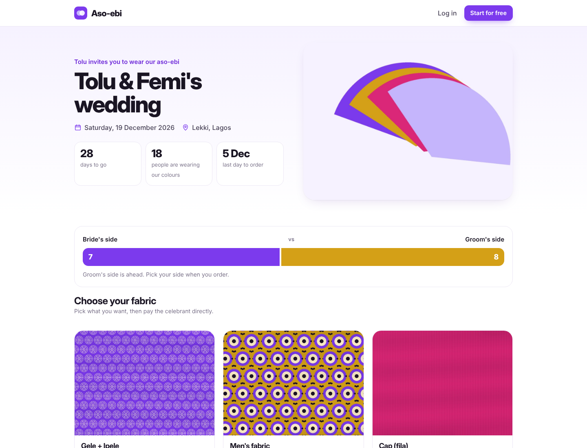
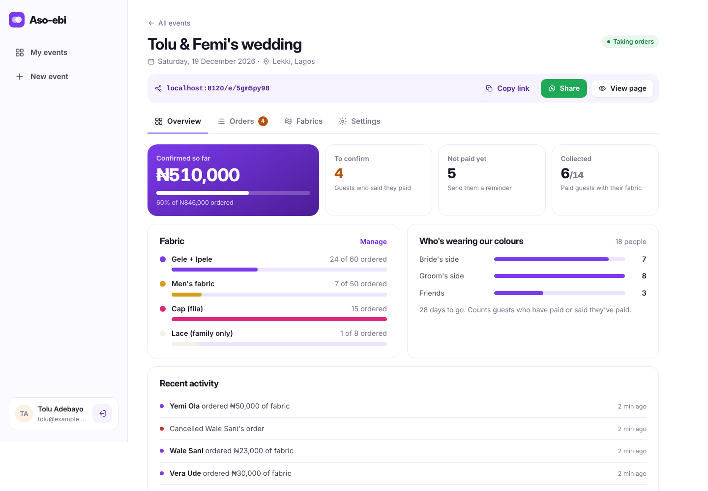
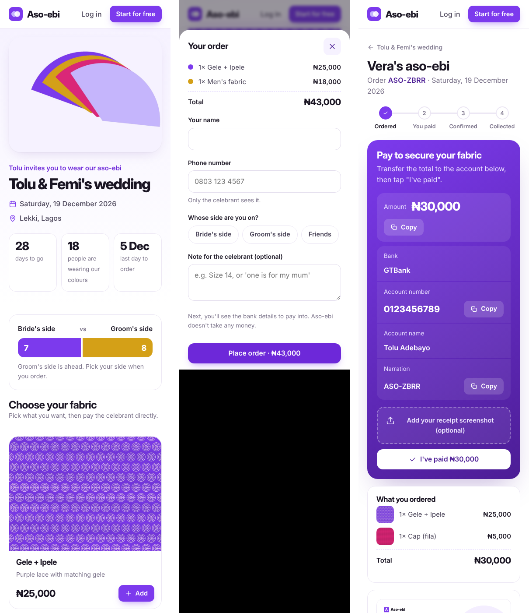

# Aso-ebi

**Your aso-ebi, sorted.** One link for your guests to pick their fabric, pay and show proof. You see who has paid and who has collected, without a messy WhatsApp list.

Day 7 of **The Daily Ship**, and my first project in **React + PHP**. Live at **[asoebi.ejikepius.dev](https://asoebi.ejikepius.dev)**.

> **Aso-ebi only keeps the record. It never holds money.** Guests pay the celebrant directly.



## Features

**For the celebrant**
- Create a wedding, birthday or burial event with a cover photo, date, venue and order deadline
- Add fabrics with photos, prices, colours and stock (it can't be oversold)
- Bank details and a pickup address that guests see after they order
- A dashboard: money confirmed vs ordered, orders to confirm, unpaid, collected, stock per fabric, live activity
- Confirm payments (with receipt photos), mark "not received", tick people off when they collect, cancel orders
- WhatsApp reminders written for you, and a CSV export for the tailor

**For guests (no account)**
- Pick fabrics and quantities, then name, phone, size note and **whose side you're on**
- A private order page with the bank details, copy buttons, a progress tracker and "I've paid" with a receipt
- A share card for WhatsApp status: "We're wearing aso-ebi for…" in the event's fabric colours

**The fun part**: a live **Bride's side vs Groom's side** tally on every wedding page.



## How it's built

```
web/   React 19 + Vite. Pages, a tiny router, one api.js for every call to PHP.
api/   PHP 8 JSON API with SQLite. Classes for events, fabrics, orders and users.
       web/public/api/index.php is the router; .htaccess sends every unknown URL to it.
```

- **Same-origin by design**: Vite proxies `/api` to PHP while developing, and on the server both live in `public_html`. No CORS, and login uses an httpOnly PHP session cookie, not tokens in localStorage.
- **CSRF**: PHP hands React a token from `/api/me`; React sends it as `X-CSRF-Token` on every change.
- **Errors with a field**: PHP answers `{ "error": "...", "field": "phone" }` and React shows the message under that input.
- **No overselling**: orders check stock inside a SQLite `BEGIN IMMEDIATE` lock.
- **Link previews**: PHP serves the React shell but writes the event's title and share card into the `og:` tags, so WhatsApp and X show a proper preview.
- **Privacy**: photos are re-saved by the server (no GPS data). Receipts are only visible to the celebrant. Bank details are only shown after ordering.
- **No UI libraries**: just React, a 40-line router and hand-written CSS, fully responsive (360px to desktop), with a bottom sheet checkout on phones.




## Run it locally

```bash
# Terminal 1: PHP API
php -S localhost:8000 web/public/api/index.php

# Terminal 2: React
cd web && npm install && npm run dev      # http://localhost:5173

php tests/run.php                         # 23 tests
cd web && npm run build                   # builds into public_html
```


Built by **Ejike Pius** ([@ejike_pius](https://x.com/ejike_pius), [ejikepius.dev](https://ejikepius.dev)). MIT licence.
